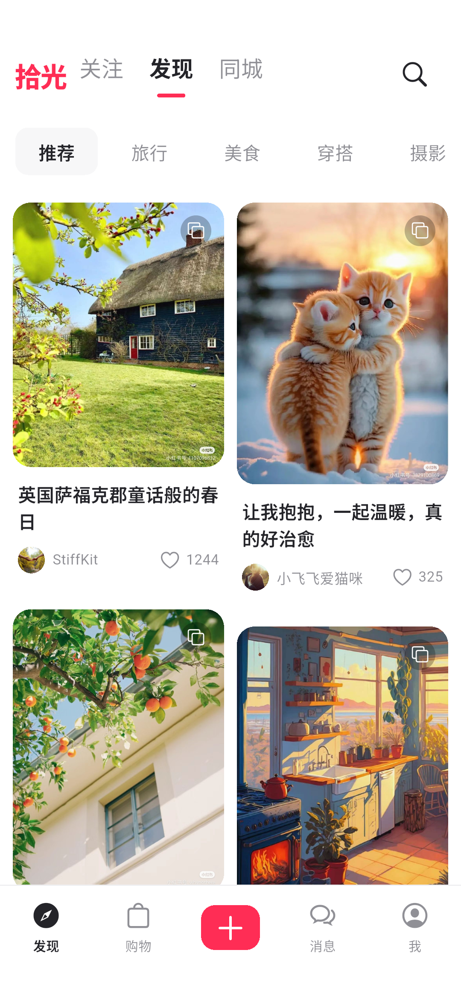
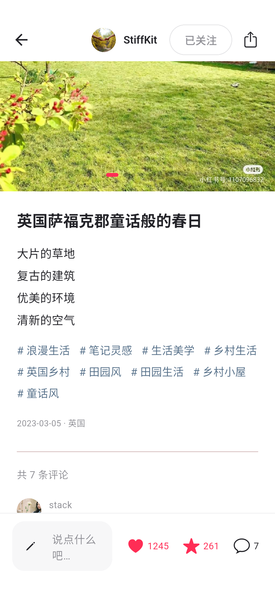
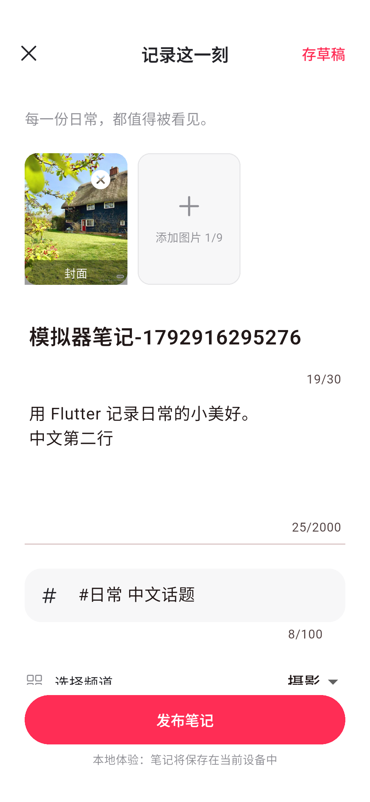
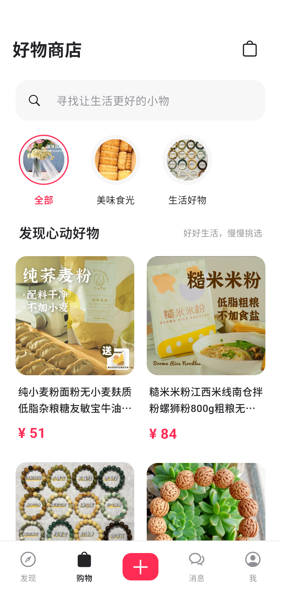
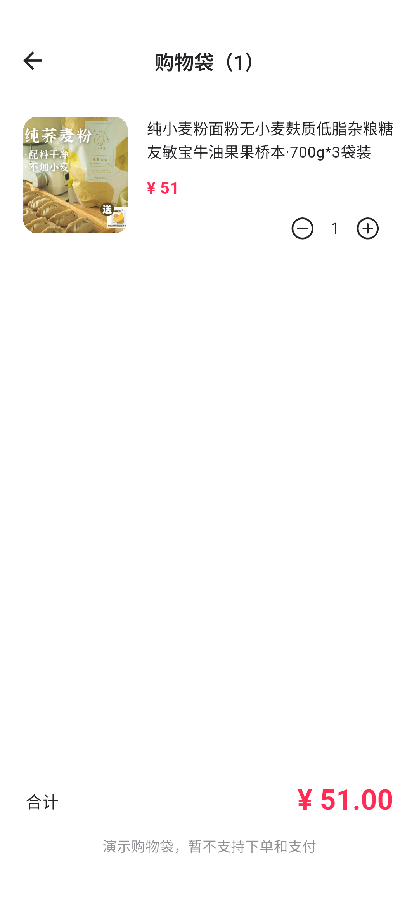
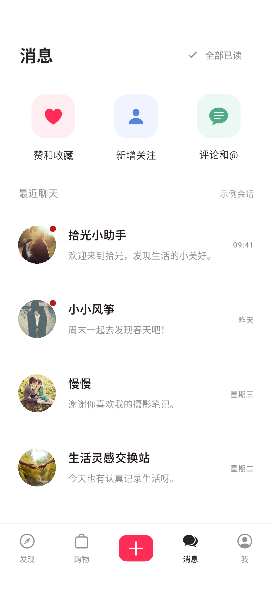
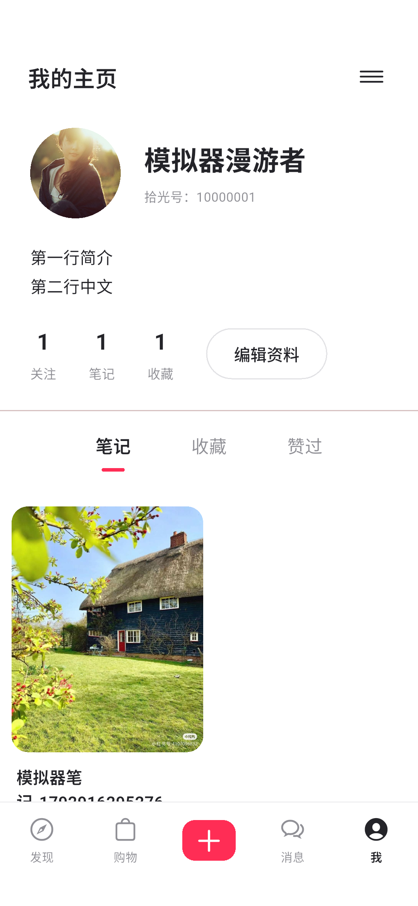
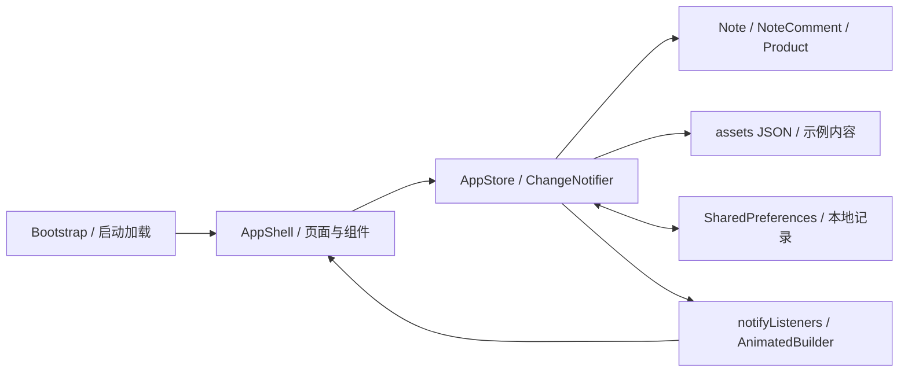

# 拾光 · Flutter 生活方式社区

使用 Flutter 实现的本地生活分享社区，包含发现、搜索、图文互动、发布、购物、消息和个人主页。提供 Android、iOS 工程及 Web 预览；手机使用底部导航与双列瀑布流，大屏使用侧栏与多列布局。内置 15 篇笔记、20 件商品和 135 张教学参考素材。

## 功能

| 模块 | 已实现内容 |
| --- | --- |
| 发现与搜索 | 推荐频道、关注流、地区筛选、刷新提示；标题、正文、作者与话题检索，搜索历史和空状态 |
| 笔记详情 | 多图切换、点赞、收藏、关注、中文评论、复制内容 |
| 发布 | 相册选图或灵感封面、标题正文、话题频道、草稿保存恢复、退出保护 |
| 购物 | 商品分类与搜索、详情弹层、购物袋数量调整和合计 |
| 消息 | 示例会话、已读标记、本地聊天记录、三类互动通知空状态 |
| 我的 | 编辑昵称简介、已发布笔记、收藏与赞过列表、关注列表和草稿入口 |
| 本地保存 | 恢复互动、发布记录、评论、草稿、搜索历史、资料、购物袋和聊天 |

## 主要界面

以下为 Android 模拟器实际运行截图，测试文字属于本地演示内容。

| 发现首页 | 中文搜索 |
| --- | --- |
|  |  |

| 笔记详情 | 发布与草稿 |
| --- | --- |
|  |  |

| 好物商店 | 购物袋 |
| --- | --- |
|  |  |

| 消息列表 | 个人主页 |
| --- | --- |
|  |  |

<details>
<summary>查看全部 28 张界面、弹窗与输入状态截图</summary>

| 分组 | 截图 |
| --- | --- |
| 发现 | [首页](docs/screenshots/guide/01-home.png)、[关注流](docs/screenshots/guide/27-follow-feed.png)、[同城](docs/screenshots/guide/28-local-feed.png) |
| 详情 | [图片](docs/screenshots/guide/02-note-detail.png)、[正文](docs/screenshots/guide/20-note-content.png)、[评论输入](docs/screenshots/guide/14-comment-keyboard.png) |
| 搜索 | [搜索入口](docs/screenshots/guide/25-search-start.png)、[中文结果](docs/screenshots/guide/04-search.png)、[无结果](docs/screenshots/guide/26-search-empty.png) |
| 发布 | [编辑与草稿](docs/screenshots/guide/05-publish-draft.png)、[退出保护](docs/screenshots/guide/29-leave-draft.png)、[发布成功](docs/screenshots/guide/06-published.png) |
| 购物 | [商店](docs/screenshots/guide/07-shop.png)、[商品详情](docs/screenshots/guide/30-product-detail.png)、[购物袋](docs/screenshots/guide/08-cart.png) |
| 消息 | [列表](docs/screenshots/guide/31-messages.png)、[赞和收藏通知](docs/screenshots/guide/32-notification-0.png)、[关注通知](docs/screenshots/guide/33-notification-1.png)、[评论通知](docs/screenshots/guide/34-notification-2.png)、[聊天](docs/screenshots/guide/09-chat.png)、[聊天输入](docs/screenshots/guide/16-chat-keyboard.png) |
| 我的 | [笔记](docs/screenshots/guide/35-profile-notes.png)、[收藏](docs/screenshots/guide/03-profile-saved.png)、[赞过](docs/screenshots/guide/21-profile-liked.png)、[关注列表](docs/screenshots/guide/22-follow-list.png)、[关于与草稿入口](docs/screenshots/guide/23-settings.png)、[资料编辑](docs/screenshots/guide/24-profile-editor.png)、[资料输入](docs/screenshots/guide/15-profile-keyboard.png) |

截图位于 `docs/screenshots/guide/`，均为 1080×2340 PNG。输入截图记录 Flutter 应用绘制层，系统键盘本体不保证包含在内。历史系统相册、原生键盘和重启恢复截图保留在 `docs/screenshots/android/`。

</details>

## 项目结构

```text
xiaohongshu/
├── README.md                     功能、截图、架构、运行与验证说明
├── pubspec.yaml / pubspec.lock    依赖、资源声明与版本锁定
├── analysis_options.yaml         静态分析配置
├── lib/
│   ├── main.dart                 启动、中文本地化、加载与错误重试
│   ├── data/
│   │   ├── models.dart           Note、NoteComment、Product 模型
│   │   └── app_store.dart        数据加载、筛选、状态变更与本地保存
│   └── ui/
│       ├── shell.dart            主页面容器、导航、侧栏与发布入口
│       ├── theme.dart            主题、图片、头像、提示与空状态
│       ├── pages/
│       │   ├── discover.dart     发现、关注与同城
│       │   ├── search.dart       搜索、历史与结果
│       │   ├── note_detail.dart  图文详情和互动
│       │   ├── publish.dart      发布、选图、草稿与退出保护
│       │   ├── shop.dart         商店、商品详情与购物袋
│       │   ├── messages.dart     消息、通知与聊天
│       │   └── profile.dart      主页、资料编辑与关注列表
│       └── widgets/
│           ├── note_grid.dart    自适应瀑布流与笔记卡片
│           └── keyboard_bar.dart 键盘避让与底部安全区
├── assets/                       笔记、商品 JSON 与图片素材
├── android/ / ios/ / web/         各平台宿主与构建配置
├── test/                         数据、输入、布局与导航测试
├── integration_test/app_test.dart Android 完整流程与截图场景
├── test_driver/                  截图接收与保存
├── tool/import_reference.cjs     教学资料导入工具
└── docs/                         截图与历史记录
```

`build/`、`.dart_tool/`、`artifacts/` 为本地生成目录，已从版本控制中忽略。

## 架构与数据流



- **启动与导航**：`Bootstrap` 加载共享 `AppStore`；`IndexedStack` 保留四个主页面状态，`Navigator` 打开搜索、详情、发布、购物袋和聊天。临时界面状态由 `StatefulWidget` 管理。
- **布局与组件**：外壳在 900 个逻辑像素起切换为侧栏，瀑布流按可用宽度显示 2～5 列；图片、头像、空状态和键盘避让共用组件。
- **状态与保存**：`AppStore.load()` 并行读取示例 JSON，再恢复 `life_notes_v1` 本地快照。页面调用状态方法后通知界面，保存任务串行执行。发布失败时撤回新笔记并恢复草稿。
- **数据组织**：笔记、评论和商品使用独立模型；点赞收藏按笔记 ID、关注按作者 ID 保存，购物袋保存商品 ID 与数量，草稿保存一份编辑内容。

## 运行与构建

已验证工具链：**Flutter 3.47.7 / Dart 3.13.5**。在项目根目录执行：

```powershell
flutter pub get
flutter run -d chrome
```

Android 可通过 `flutter emulators` 查看模拟器，启动后用 `flutter devices` 确认设备 ID：

```powershell
flutter emulators --launch flutter_emulator
flutter run -d emulator-5554
flutter build apk --debug --target-platform android-x64
```

设备 ID 按本机实际输出调整，已启动的模拟器无需重复启动。APK 输出为 `build/app/outputs/flutter-apk/app-debug.apk`，本机另保留 `artifacts/android/shiguang-emulator-debug.apk`。该包用于 x86_64 模拟器，ARM 手机需构建匹配架构的包。iOS 构建需要 macOS、Xcode 和签名配置。

Web 构建与预览：

```powershell
flutter build web --no-wasm-dry-run --output=build/web
python -m http.server 5173 --bind 127.0.0.1 --directory build/web
```

访问 [本地预览](http://127.0.0.1:5173)。浏览器本地记录与来源绑定，切换浏览器或端口会使用不同记录；首次加载渲染组件和中文字体可能需要联网。

## 测试与验证

**2026-10-25 验证结果**：

| 检查 | 结果 |
| --- | --- |
| 静态分析 | 通过，无问题 |
| 自动化测试 | 12 项通过：数据 3 项、输入与受限高度布局 6 项、不同尺寸导航 3 项 |
| Android 模拟器 | Android 15 / API 35 / x86_64，完整业务流程通过；普通调试版已重新安装并启动 |
| Web 构建 | 通过 |
| 截图与文档 | 28 张模拟器截图，正文插入八张主要界面图 |

```powershell
flutter analyze
flutter test --concurrency=1
$env:SCREENSHOT_DIR = 'docs/screenshots/guide'
flutter drive --driver=test_driver/integration_test.dart --target=integration_test/app_test.dart -d emulator-5554
Remove-Item Env:SCREENSHOT_DIR
```

覆盖浏览互动、中文搜索和输入、资料编辑、草稿恢复与发布、购物袋增减及本地聊天；导航测试包含 320×740、390×844、1440×900 三种逻辑尺寸。集成测试会临时修改目标设备数据，完成时恢复测试前快照，应使用开发模拟器。截图默认目录为 `docs/screenshots/android/`，环境变量可指定其他位置。Windows 测试引擎曾意外退出，最终独立串行重跑全部通过，建议依次执行上述步骤。

本轮已合并重复的详情跳转与购物袋逻辑、删除配置模板注释、取消截图字节的重复 JSON 输出，并修复键盘展开时空状态高度不足的溢出问题，补充滚动与按钮操作回归测试。

## 当前范围

当前为本地 MVP：未接入真实账号、远程发布、推荐服务、消息投递、订单或支付。同城仅按示例地区筛选，下拉刷新提供本地提示。Android/iOS 真机、iOS 构建、性能与真实服务端流程未在本轮验证；系统相册和进程重启恢复沿用历史验证记录。

相册最多 9 张，处理后单图限制 1.5 MB，选图以 base64 保存到本地草稿或笔记。`SharedPreferences` 适用于少量演示记录，大量图片可能达到存储配额；清除应用或站点数据会移除记录。后续应把图片迁至文件系统或对象存储、记录迁至数据库，再从数据层接入服务端。

教学资料对应关系与后续接入建议保留在 [参考资料与后续开发](docs/参考资料与后续开发.md)。
